# EventPass — Raport 2: Proiectare și implementare minimală

**Proiect:** EventPass — platformă web de vânzare a biletelor la evenimente, cu plată online și bilet cu cod QR\
**Autor:** Nicușor Mijache\
**Repository:** [github.com/NicuMijache/EventPass](https://github.com/NicuMijache/EventPass)\
**Etapa:** Raport 2 — Proiectare și implementare minimală (milestone GitHub, issue-urile #6–#15)\
**Data:** noiembrie 2026

---

## Cuprins

1. [Scopul etapei](#1-scopul-etapei)
2. [Ce s-a implementat](#2-ce-s-a-implementat)
3. [Arhitectura aplicației](#3-arhitectura-aplicației)
4. [Modelul de date](#4-modelul-de-date)
5. [Autentificare și roluri](#5-autentificare-și-roluri)
6. [API-ul REST](#6-api-ul-rest)
7. [Fluxul de cumpărare și plată](#7-fluxul-de-cumpărare-și-plată)
8. [Biletul: cod QR și email](#8-biletul-cod-qr-și-email)
9. [Securitate](#9-securitate)
10. [Testare și integrare continuă](#10-testare-și-integrare-continuă)
11. [Capturi de ecran](#11-capturi-de-ecran)
12. [Rulare locală](#12-rulare-locală)
13. [Etapa următoare](#13-etapa-următoare)

---

## 1. Scopul etapei

Raportul 1 a stabilit problema (vânzarea biletelor la evenimente fără bilete fizice și fără fraudă la intrare), cerințele, cazurile de utilizare și instrumentele. Această etapă proiectează sistemul și implementează **fluxul minimal complet**, de la un cont nou până la biletul primit pe email:

> Organizatorul creează un eveniment cu tipuri de bilete → clientul alege biletele → locurile se rezervă → clientul plătește prin Stripe (mod test) → Stripe confirmă plata serverului (webhook) → serverul emite biletele, fiecare cu un cod QR unic → clientul primește biletele pe email.

Fiecare funcționalitate a fost lucrată pe o ramură separată (`feature/<nume>`), integrată prin Pull Request cu build și teste automate (GitHub Actions) și legată de issue-ul ei.

## 2. Ce s-a implementat

| Issue | Funcționalitate | Pull Request |
|---|---|---|
| #6 | Model de date și migrări EF Core (PostgreSQL) | #27 |
| #7 | Autentificare JWT și roluri (Client, Organizer, Staff, Admin) | #28 |
| #8 | CRUD evenimente și tipuri de bilete (organizator), publicare, poster | #29 |
| #9 | Pagina publică de evenimente cu filtre și pagina de detalii | #30 |
| #10 | Rezervarea locurilor și comanda (`Order`) în stare `Pending` | #31 |
| #11 | Plata prin Stripe Checkout (mod test) | #32 |
| #12 | Webhook Stripe cu verificarea semnăturii și emiterea biletelor | #33 |
| #13 | Generarea codului QR cu QRCoder | #34 |
| #14 | Trimiterea biletelor cu QR pe email (MailKit) | #35 |

Toate issue-urile de mai sus sunt închise; fiecare PR a trecut prin CI (build + teste) înainte de integrare în `main`.

## 3. Arhitectura aplicației

Aplicația are trei componente proprii (frontend, backend, bază de date) și două servicii externe (procesatorul de plăți și serverul de email).

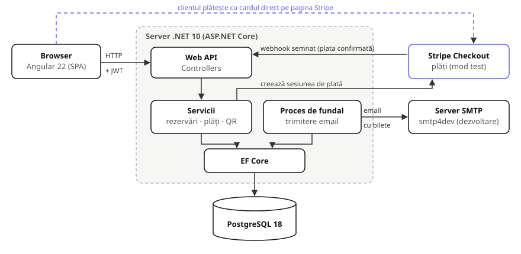

**Backend (ASP.NET Core Web API, .NET 10)** — organizat pe straturi:

| Strat | Rol | Exemple |
|---|---|---|
| `Controllers` | Primesc cererile HTTP, verifică dreptul de acces, întorc DTO-uri | `OrdersController`, `StripeWebhookController` |
| `Services` | Regulile de business, testabile separat | `SeatReservationService`, `OrderPaymentService`, `TicketEmailService` |
| `Data` | Accesul la baza de date (EF Core), migrări | `AppDbContext`, `Migrations/` |
| `Models` | Entitățile din baza de date | `Event`, `Order`, `Ticket` |
| `Dtos` | Ce intră și ce iese prin API (separat de entități) | `CreateOrderRequest`, `OrderDto` |

Dependențele externe sunt ascunse în spatele unor interfețe (`IPaymentGateway`, `IEmailSender`, `IQrCodeGenerator`), astfel încât testele folosesc variante false, fără internet.

**Frontend (Angular 22, componente standalone, signals):**

| Folder | Rol |
|---|---|
| `core/services` | Comunicarea cu API-ul (`AuthService`, `EventsService`, `OrdersService`) |
| `core/interceptors` | Adaugă tokenul JWT la fiecare cerere |
| `core/guards` | Protejează paginile (doar logat, doar anumite roluri) |
| `pages` | Paginile: evenimente, detalii, login, cont nou, comenzi, comanda |
| `components` | Piese refolosite: cardul de eveniment, panoul de filtre, codul QR |

**Tehnologii și versiuni:**

| Zonă | Tehnologie |
|---|---|
| Backend | .NET 10, ASP.NET Core Web API, EF Core 10, Npgsql |
| Frontend | Angular 22, TypeScript 6, Vitest (teste) |
| Bază de date | PostgreSQL 18 |
| Plăți | Stripe Checkout + Webhooks (mod test), `Stripe.net` 53 |
| Cod QR | `QRCoder` 1.8 |
| Email | `MailKit` 4.18; `smtp4dev` (server SMTP de test) |
| Autentificare | JWT Bearer, `PasswordHasher` (PBKDF2) |
| Documentare API | OpenAPI + Swagger UI |
| Teste / CI | xUnit, SQLite în memorie, GitHub Actions |

## 4. Modelul de date

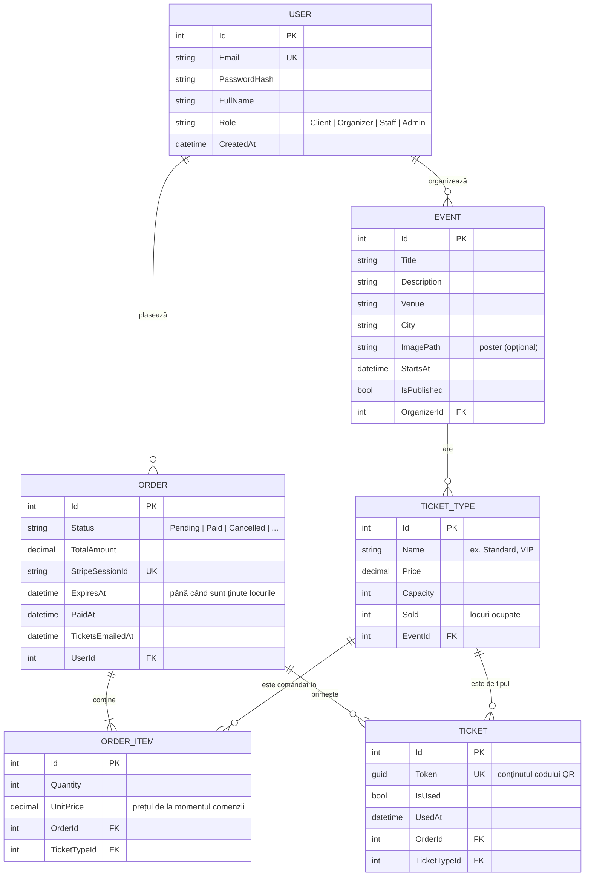

Decizii importante:

- **Stocul** se ține în `TicketType.Sold` (locuri ocupate). Baza de date are o regulă `CHECK (Sold >= 0 AND Sold <= Capacity)`: chiar dacă un cod greșit ar încerca, nu se pot vinde mai multe locuri decât există.
- **Prețul** se copiază în `OrderItem.UnitPrice` la crearea comenzii: dacă organizatorul schimbă ulterior prețul, comenzile vechi rămân corecte.
- **Biletul** are un `Token` (GUID aleator, 122 de biți aleatori) cu **index unic**: acesta e conținutul codului QR și nu poate fi ghicit.
- `StripeSessionId` e unic: o plată Stripe corespunde unei singure comenzi.
- Stările (`Status`, `Role`) se salvează ca text, nu ca numere, ca baza de date să fie lizibilă.
- Ștergerile în cascadă sunt dezactivate (`Restrict`) pentru comenzi și bilete: istoricul financiar nu dispare accidental.
- Toate datele calendaristice se salvează în UTC; banii folosesc `decimal(10,2)`.

Schema e creată și modificată exclusiv prin **migrări EF Core** (`dotnet ef database update`), versionate în repository.

## 5. Autentificare și roluri

- La **înregistrare**, parola se salvează doar ca hash (`PasswordHasher`, PBKDF2 cu sare), niciodată în clar.
- La **login**, serverul emite un **token JWT** semnat (valabil 60 de minute), care conține id-ul, emailul, numele și rolul. Cheia de semnare stă în User Secrets, nu în cod.
- Frontend-ul păstrează tokenul și îl trimite automat la fiecare cerere (un *interceptor* adaugă antetul `Authorization: Bearer …`).
- Fiecare endpoint declară cine are acces (`[Authorize]`, `[Authorize(Roles = "Organizer")]`); în interfață, *guard*-urile ascund paginile pentru care utilizatorul nu are drepturi.

| Rol | Poate |
|---|---|
| Client | vedea evenimentele, rezerva, plăti, vedea propriile comenzi și bilete |
| Organizer | gestiona propriile evenimente și tipuri de bilete, publica / retrage evenimente |
| Staff | (etapa finală) scana biletele la intrare |
| Admin | schimba rolurile utilizatorilor; primul Admin se creează automat la pornire (date din User Secrets) |

Un utilizator nu vede niciodată resursele altcuiva: pentru comanda sau evenimentul altcuiva serverul răspunde **404**, ca și cum n-ar exista (nu dezvăluie nici măcar existența lor).

## 6. API-ul REST

API-ul e documentat automat (OpenAPI) și poate fi încercat din Swagger UI (`/swagger`). Endpoint-urile din această etapă:

| Metodă | Rută | Acces | Rol |
|---|---|---|---|
| POST | `/api/auth/register` | public | cont nou |
| POST | `/api/auth/login` | public | login → token JWT |
| GET | `/api/auth/me` | logat | utilizatorul curent |
| GET | `/api/events` | public | evenimentele publicate, viitoare, cu filtre (oraș, locație, căutare după text) |
| GET | `/api/events/filters` | public | opțiunile pentru panoul de filtre |
| GET | `/api/events/{id}` | public | detaliile unui eveniment și biletele disponibile |
| GET / POST | `/api/organizer/events` | Organizer | evenimentele mele / eveniment nou (ciornă) |
| GET / PUT / DELETE | `/api/organizer/events/{id}` | Organizer | un eveniment al meu |
| POST / DELETE | `/api/organizer/events/{id}/image` | Organizer | posterul (JPG / PNG / WebP, max. 5 MB, conținut verificat) |
| POST | `/api/organizer/events/{id}/publish` · `/unpublish` | Organizer | publicare / retragere |
| POST / PUT / DELETE | `/api/organizer/events/{eventId}/ticket-types[/{id}]` | Organizer | tipurile de bilete |
| POST | `/api/orders` | logat | comandă nouă: rezervă locurile 15 minute |
| GET | `/api/orders/mine` · `/api/orders/{id}` | logat | comenzile mele / o comandă |
| POST | `/api/orders/{id}/checkout` | logat | creează sesiunea Stripe, întoarce adresa paginii de plată |
| POST | `/api/orders/{id}/cancel` | logat | renunță la rezervare (locurile se eliberează) |
| GET | `/api/orders/{orderId}/tickets/{ticketId}/qr` | logat | imaginea QR a unui bilet (PNG) |
| POST | `/api/webhooks/stripe` | semnătură Stripe | confirmarea plății de la Stripe |
| PUT | `/api/users/{id}/role` | Admin | schimbarea rolului |

Erorile au un format unic (`{ "message": "…" }` sau erori de validare pe câmpuri), afișat direct în interfață, în română.

## 7. Fluxul de cumpărare și plată

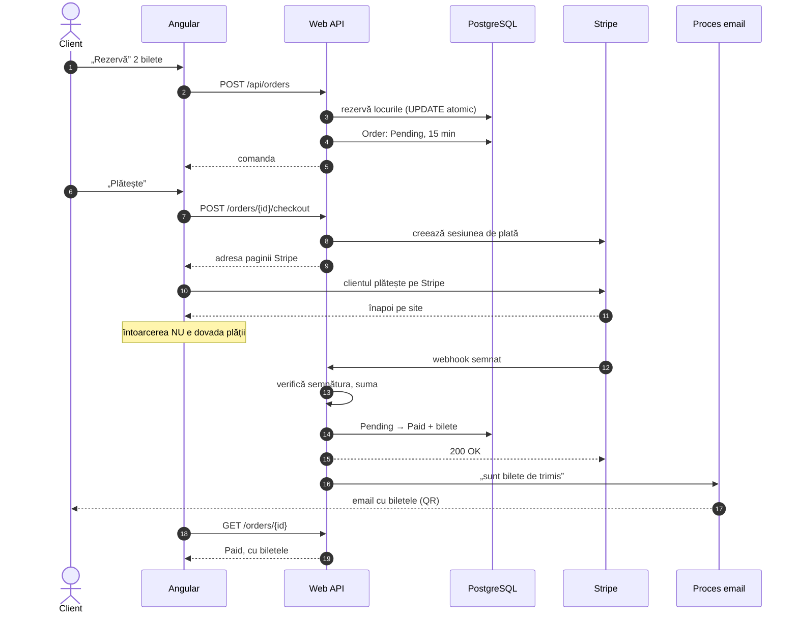

Deciziile care fac fluxul corect și sigur:

1. **Rezervarea e atomică.** Verificarea locurilor libere și scăderea stocului sunt o singură comandă SQL (`UPDATE … WHERE Sold + n <= Capacity`). Dacă doi clienți cer ultimul loc în același moment, baza de date le execută pe rând: primul îl primește, al doilea primește „s-au epuizat”. Toate liniile unei comenzi se rezervă într-o tranzacție (totul sau nimic).
2. **Prețul îl calculează serverul**, din baza de date; clientul trimite doar ce bilete vrea și câte (maximum 10 pe comandă, maximum 3 rezervări neplătite pe utilizator).
3. **Rezervarea expiră:** locurile sunt ținute 15 minute; după „Plătește”, cât e valabilă sesiunea Stripe (31 de minute, minimul cerut de Stripe), ca să nu expire în timp ce clientul e pe pagina de plată. O comandă expirată se anulează și își eliberează locurile.
4. **Doar Stripe confirmă plata.** Întoarcerea clientului pe site nu schimbă nimic: comanda devine `Paid` doar prin webhook-ul Stripe, a cărui **semnătură HMAC** (calculată cu un secret comun, pe textul exact al mesajului) se verifică; mesajele mai vechi de 5 minute sunt respinse (protecție la retrimiterea unui mesaj interceptat).
5. **Verificări suplimentare:** suma, moneda și id-ul sesiunii trebuie să fie exact cele ale comenzii.
6. **Idempotență:** Stripe poate trimite același mesaj de mai multe ori. Trecerea `Pending → Paid` e un `UPDATE … WHERE Status = Pending`: doar primul mesaj trece, celelalte nu emit bilete în plus.
7. **Banii sunt numere întregi** (bani, nu lei cu virgulă), cum cere Stripe, ca să nu apară erori de rotunjire.
8. **Datele cardului nu trec niciodată prin serverul nostru:** clientul le introduce direct pe pagina Stripe.

## 8. Biletul: cod QR și email

**Codul QR.** Conținutul QR-ului e tokenul biletului (GUID), scris cu majuscule: așa intră în modul „alfanumeric” al standardului QR, mai compact, deci codul are pătrățele mai mari și se scanează mai ușor. Nivelul de corecție a erorilor e Q (~25%): codul se citește și dacă e parțial acoperit sau zgâriat. Sub cod apare un **cod scurt** de 8 caractere (ex. `CF727746`), pentru introducere manuală. Imaginea se generează la cerere (nu se salvează), iar răspunsul are antetul `Cache-Control: private, no-store`, ca biletul să nu rămână în memoria cache.

**Emailul.** Trimiterea nu se face în timpul webhook-ului (Stripe așteaptă un răspuns rapid, iar un email eșuat nu trebuie să anuleze o plată reușită). Starea „email trimis / de trimis” stă în baza de date (`TicketsEmailedAt`, numărul de încercări), iar un **proces de fundal** trimite emailurile: imediat ce e anunțat de webhook și, la eșec, reîncearcă după pauze tot mai lungi (2, 4, 8… minute, maximum 6 încercări). Pentru că starea e în baza de date, nimic nu se pierde la o repornire a serverului.

Emailul (HTML + variantă text) conține evenimentul, fiecare bilet cu codul QR inclus direct în mesaj (imagini „inline”, `cid:`) și codul scurt. Textele introduse de utilizatori sunt „escapate”, ca să nu poată injecta HTML. În dezvoltare, emailurile ajung în **smtp4dev**, un server SMTP de test cu interfață web.

## 9. Securitate

| Măsură | Implementare |
|---|---|
| Secrete în afara codului | User Secrets local (cheia JWT, șirul de conexiune, cheile Stripe), GitHub Secrets în CI; nimic în repository |
| Parole | hash PBKDF2 cu sare, niciodată în clar |
| Acces | JWT + roluri pe fiecare endpoint; 404 pentru resursele altcuiva |
| Plăți | datele cardului doar la Stripe; confirmarea doar prin webhook semnat, verificat (semnătură, vechime, sumă, monedă, sesiune) |
| Integritatea stocului | `UPDATE` atomic + regula `CHECK` în baza de date |
| Bilete | token aleator unic (index unic), imaginea QR nu se păstrează în cache |
| Fișiere încărcate | doar imagini (verificate după conținut, nu după extensie), max. 5 MB, nume generat de server |
| Intrări | validare pe server (adnotări pe DTO-uri), limite de lungime și cantitate |
| Email | conținut escapat, antete protejate la injectare |

## 10. Testare și integrare continuă

- **Backend (xUnit):** testele folosesc o bază **SQLite reală, în memorie** (nu un simulator), ca să verifice tranzacțiile, `UPDATE`-urile condiționate și regulile `CHECK` exact cum le execută o bază de date. Testele de cursă rulează cereri în paralel, pe conexiuni separate (ex. 30 de clienți pentru 5 locuri: exact 5 reușesc). Stripe și serverul de email sunt înlocuite în teste prin variante false.
- **Frontend (Vitest):** componentele și serviciile sunt testate cu un server HTTP simulat.
- **Probe reale:** fluxul complet a fost verificat și manual / automat în Chrome, cu PostgreSQL și Stripe în mod test (inclusiv plata cu cardul de test `4242 4242 4242 4242`).
- **CI (GitHub Actions):** la fiecare push și Pull Request către `main` rulează două job-uri — backend (restore, build, teste, raport de acoperire) și frontend (instalare, teste, build). Un PR se integrează doar cu ambele job-uri verzi.

La data acestui raport: **300 de teste backend și 186 de teste frontend**, toate trecând; acoperirea codului backend este de **~80% din linii** (fără codul generat automat), cu 92–100% pe serviciile care conțin regulile critice (rezervări, plăți, validare).

## 11. Capturi de ecran

Fluxul unui client nou, Maria Ionescu, care cumpără 3 bilete la „Nocturne Jazz Session”.

**Pagina principală** — evenimentele publicate, cu filtre (oraș, locație) și căutare:

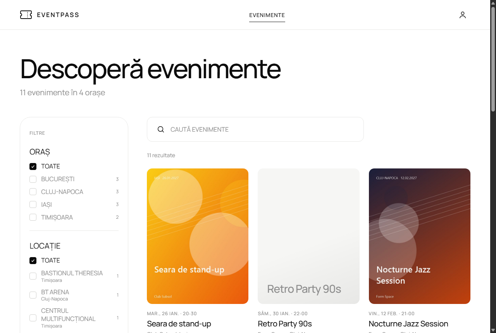

**Contul nou** — biletele vor veni pe emailul introdus aici:

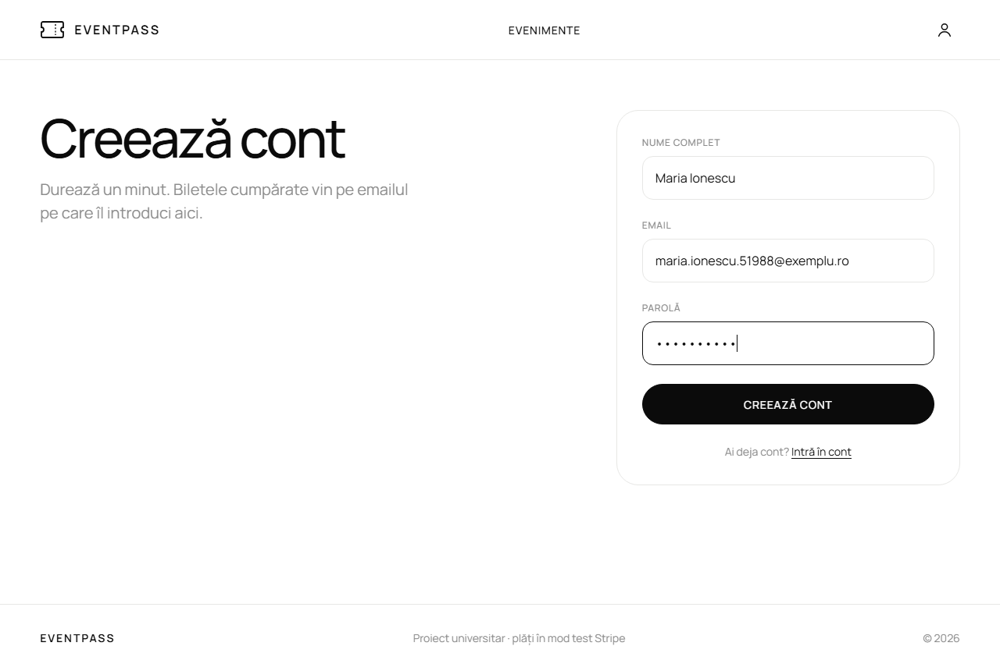

**Pagina evenimentului** — tipurile de bilete, cu prețul și disponibilitatea; totalul se calculează pe loc:

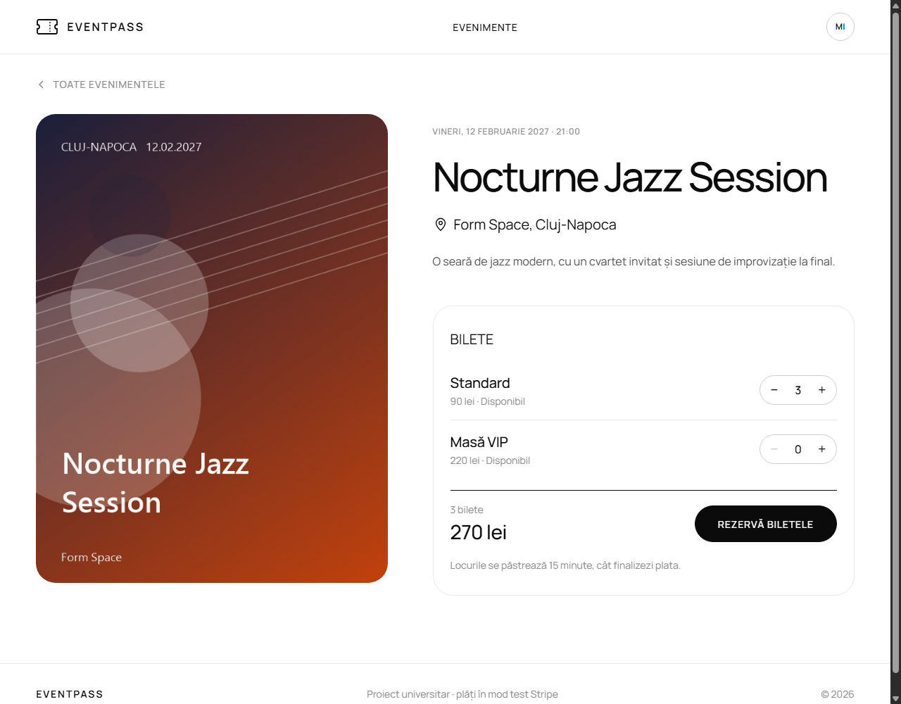

**Comanda rezervată** — locurile sunt ținute 15 minute; numărătoarea inversă arată timpul rămas:

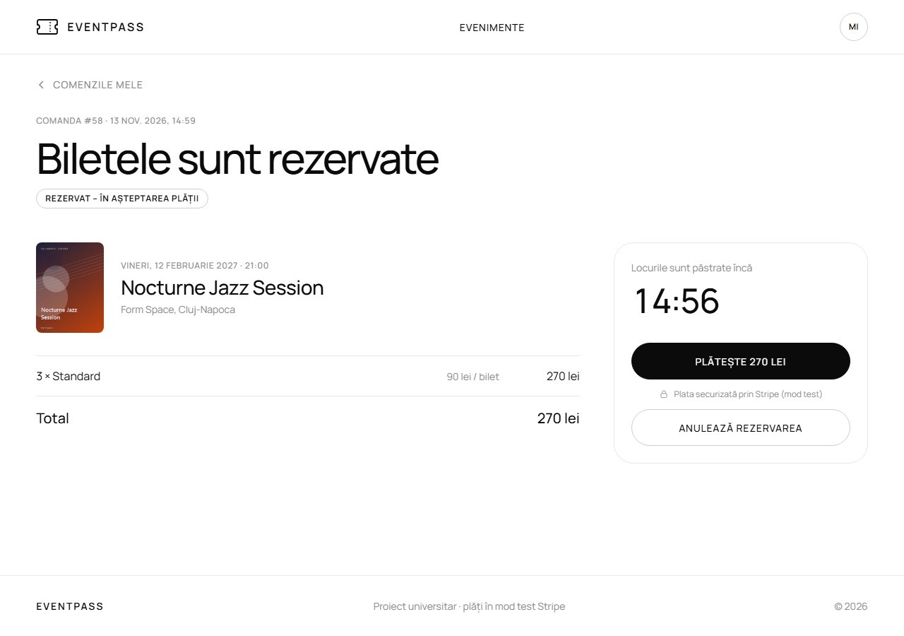

**Plata pe pagina Stripe** (mod test, cardul `4242 4242 4242 4242`) — datele cardului nu ajung la serverul nostru:

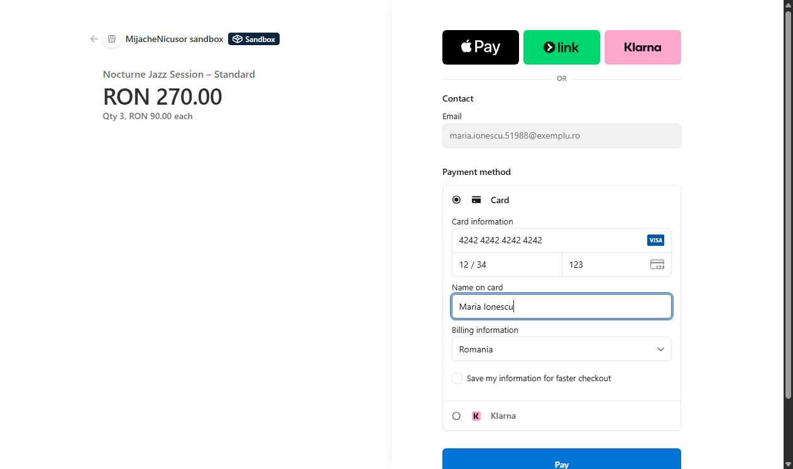

**Comanda plătită** — după confirmarea prin webhook, biletele apar singure pe pagină, fiecare cu codul QR și codul scurt:

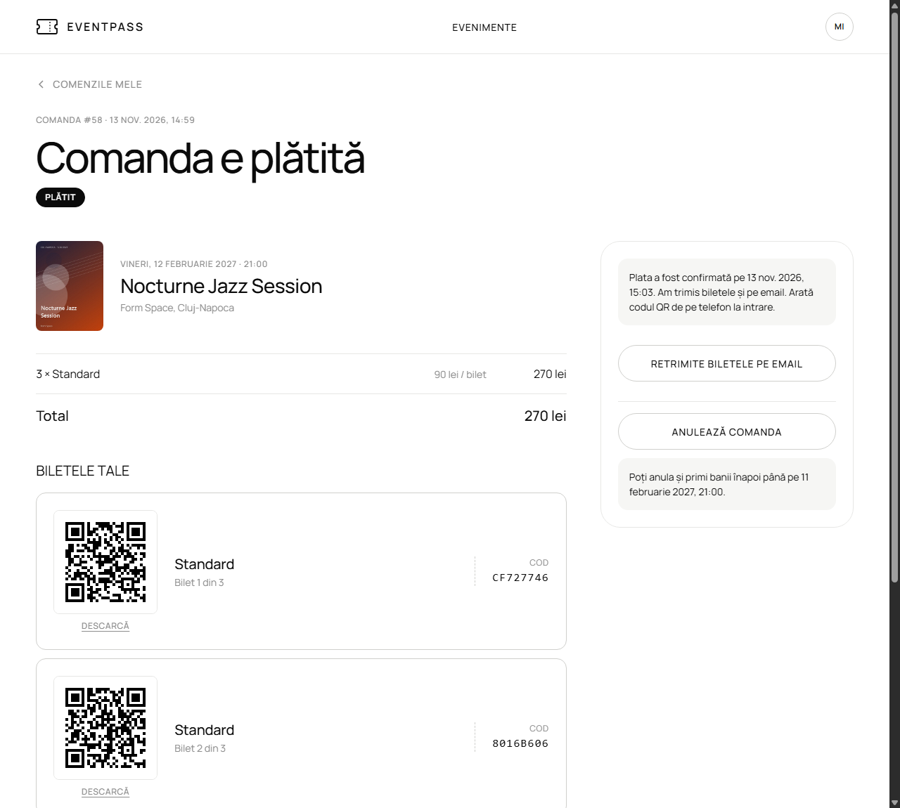

**Emailul cu biletele** — trimis de procesul de fundal, cu codurile QR incluse în mesaj:

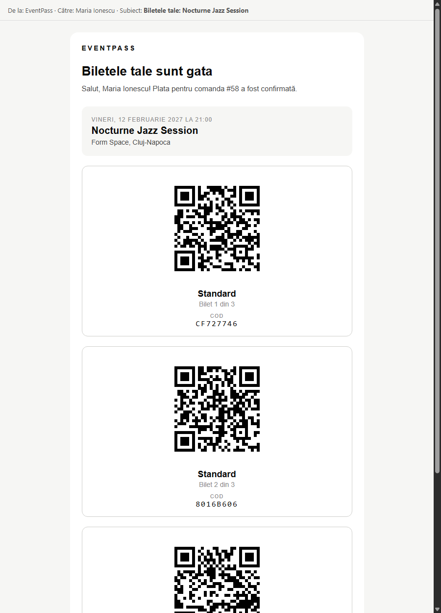

**Documentația API (Swagger UI)** — fiecare endpoint poate fi încercat direct, cu tokenul JWT („Authorize”):

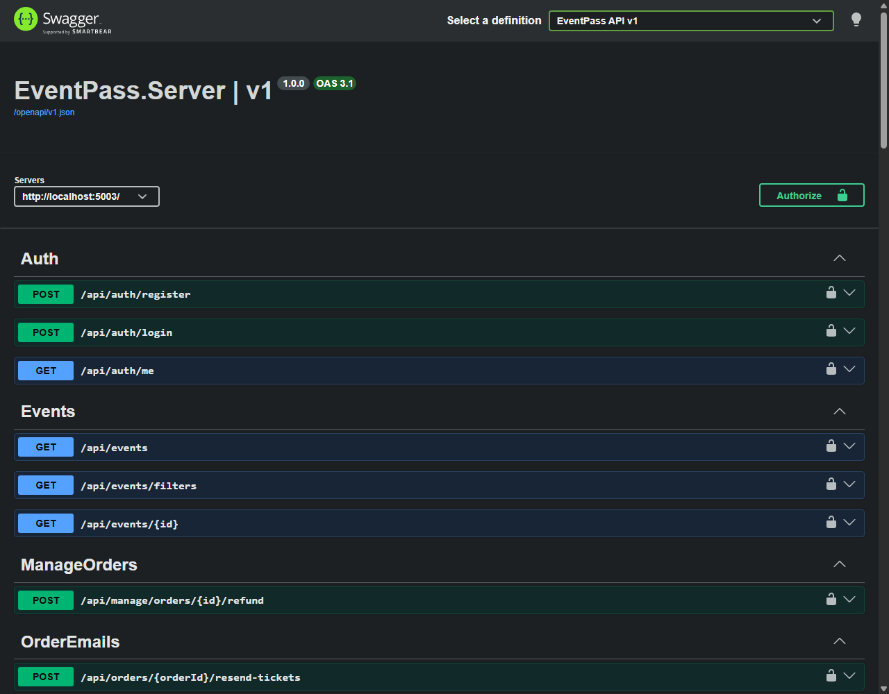

## 12. Rulare locală

Pașii completi sunt în [README](../README.md). Pe scurt:

1. `npm install` în `eventpass.client`; secretele în User Secrets (`ConnectionStrings:DefaultConnection`, `Jwt:Key`, `SeedAdmin:*`, `Stripe:SecretKey`, `Stripe:WebhookSecret`).
2. `dotnet ef database update --project EventPass.Server` — creează schema în PostgreSQL.
3. `dotnet tool restore` și `dotnet tool run smtp4dev` — serverul de email de test (http://localhost:5025).
4. `stripe listen --forward-to http://localhost:5003/api/webhooks/stripe` — aduce webhook-urile Stripe pe calculatorul local.
5. `dotnet run --project EventPass.Server --launch-profile http` (API + Swagger pe portul 5003) și `npm start` în `eventpass.client` (site pe http://localhost:4200).

## 13. Etapa următoare

Etapa finală (milestone „Raport final”) extinde fluxul minimal spre ce se întâmplă **la eveniment** și **după vânzare**:

- scanarea codului QR din browser, de pe telefonul personalului (#16);
- validarea biletului la intrare: existent, plătit, nefolosit — a doua scanare e respinsă (#17);
- gestionarea concurenței la stoc și eliberarea automată a rezervărilor expirate (#18);
- anularea comenzilor și rambursarea prin Stripe (#19);
- panoul organizatorului: vânzări, încasări, participanți (#20);
- retrimiterea biletelor pe email (#21);
- teste unitare dedicate regulilor critice (#22);
- mediul de dezvoltare cu Docker Compose (#23);
- documentația finală și prezentarea (#24).
